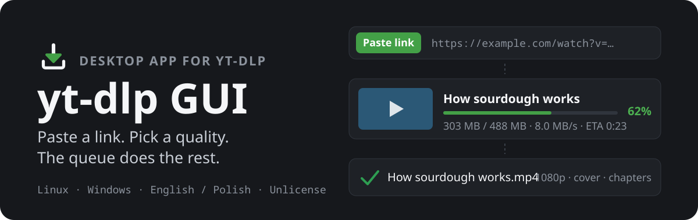
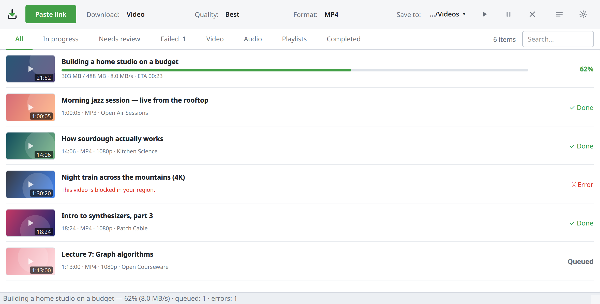
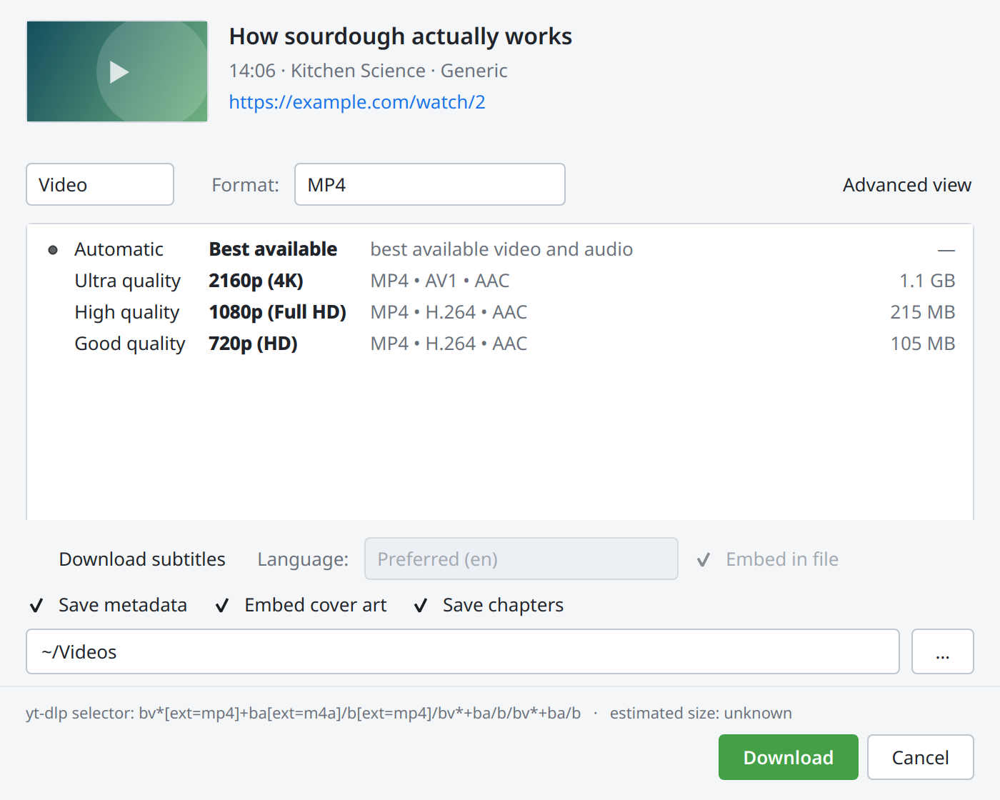
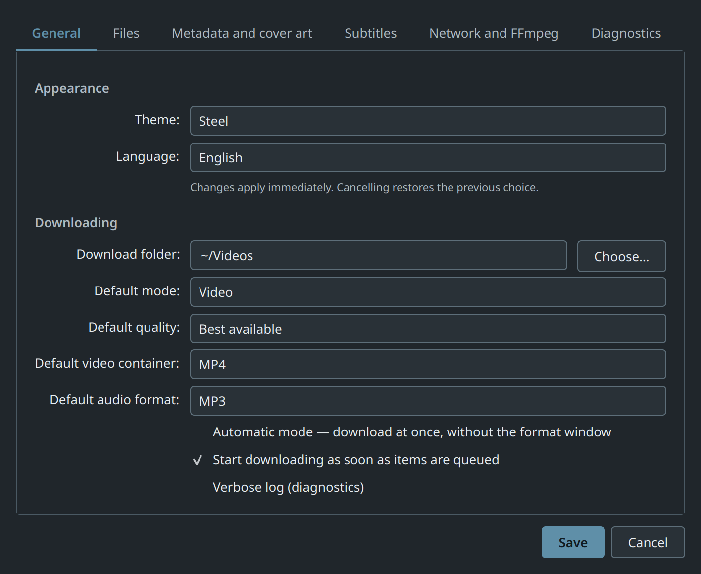
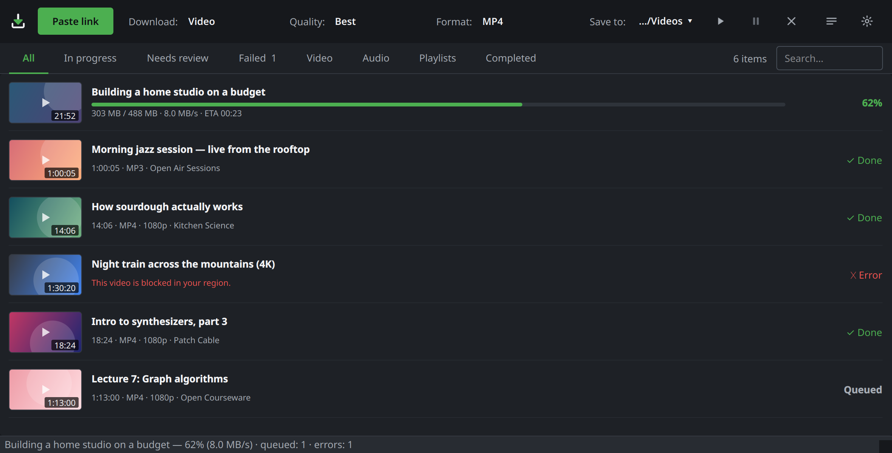

<p align="center">
  
</p>

<p align="center">
  <a href="https://github.com/zvgelo/yt-dlp-gui/releases/latest"><b>Download</b></a> ·
  <a href="#first-download">First download</a> ·
  <a href="#running-from-source">Run from source</a> ·
  <a href="docs/ARCHITECTURE.md">How it works</a> ·
  <a href="CHANGELOG.md">Changelog</a>
</p>

<p align="center">
  
</p>

**yt-dlp GUI** is a native desktop application (Qt / PySide6) for
[yt-dlp](https://github.com/yt-dlp/yt-dlp). Paste a link, pick a quality and a
format, and it downloads the video or audio together with its cover art, tags,
chapters and subtitles.

The release is one self-contained file: Python, Qt, yt-dlp, FFmpeg and a
JavaScript runtime travel inside it, so there is nothing to install first.

## What it does

- **Offers only what the media has.** The quality list comes from the formats
  yt-dlp actually found. If a video tops out at 1080p, 4K is not on the list.
- **Video or audio.** MP4, MKV or WebM, produced by merging and lossless
  remuxing instead of re-encoding. Audio comes out as MP3, M4A, AAC, Opus, FLAC
  or WAV.
- **A real queue.** Progress, speed, ETA and post-processing stages. You can
  pause, cancel and retry, and the queue is split into *In progress*, *Needs
  review*, *Failed* and *Completed*.
- **Playlists as one job.** A playlist is one row with its own counters. If
  yt-dlp cannot read a later page, the items already found are kept and the
  count is shown as partial.
- **Readable failures.** A private, geo-blocked or removed video gets a plain
  sentence and a hint. Network errors are retried on their own, and the full
  yt-dlp message is one click away.
- **No accidental duplicates.** Downloading the same file to the same folder
  again is skipped. The same video in a different format or folder waits for
  your decision.
- **Remembers.** A local history survives restarts and recovers interrupted
  downloads. Clearing it never deletes a file.
- **Your way.** Light, Dark and Steel themes, English and Polish, cookies from
  your browser, a proxy, rate limiting and SponsorBlock.

<table>
  <tr>
    <td width="50%"></td>
    <td width="50%"></td>
  </tr>
  <tr>
    <td align="center"><sub>Pick a quality the media really offers</sub></td>
    <td align="center"><sub>Preferences in the Steel theme</sub></td>
  </tr>
</table>

<p align="center">
  
</p>

## Download

Get the file from the [latest release](https://github.com/zvgelo/yt-dlp-gui/releases/latest).

### Linux (AppImage)

```bash
chmod +x yt-dlp-gui-*-x86_64.AppImage
./yt-dlp-gui-*-x86_64.AppImage
```

It runs on Debian 11, Ubuntu 20.04, RHEL 9, Fedora 34 and anything newer
(x86_64). Only the graphics stack comes from your system (`libGL`, `libEGL`,
fontconfig, D-Bus, X11), and every desktop already has it. If your system has
no FUSE, add `--appimage-extract-and-run`.

### Windows

The Windows packaging (portable ZIP and installer) is built in CI but has not
yet been checked on a native Windows machine, so it is not offered as a
release yet. [Running from source](#running-from-source) works on Windows
today.

### Verify the download

```bash
sha256sum -c SHA256SUMS.txt
./yt-dlp-gui-*-x86_64.AppImage --version
```

`release-manifest.json` next to the artifact records the commit it was built
from and the version of every bundled component.

## First download

1. Copy a link to a video, a track or a playlist.
2. Click **Paste link** (or press <kbd>Ctrl</kbd>+<kbd>V</kbd> in the window).
3. Choose **Video** or **Audio**, a quality and a format, then **Download**.

The file is saved to the folder shown under **Save to** in the top bar.
Turn on **Automatic mode** in Preferences to skip the dialog and use your
defaults every time. URLs passed on the command line are queued at start-up:

```bash
./yt-dlp-gui-*-x86_64.AppImage "https://www.youtube.com/watch?v=…"
```

## Running from source

Needs Python 3.10 or newer.

```bash
git clone https://github.com/zvgelo/yt-dlp-gui.git
cd yt-dlp-gui
python -m venv .venv
source .venv/bin/activate          # Windows: .venv\Scripts\activate
pip install -e .
./scripts/bootstrap_dev_runtime.sh # optional: the same FFmpeg and Deno a release bundles
                                   # Windows: python scripts/runtime_deps.py --development
./run.sh                           # Windows: run.bat, or: python main.py
```

Without the bootstrap step, FFmpeg and [Deno](https://deno.com/) 2.3+ are taken
from your `PATH`. The app still starts without them and says what is
unavailable, though YouTube offers fewer formats without a JavaScript runtime.

Tests, translations and release builds are covered in
[`docs/DEVELOPMENT.md`](docs/DEVELOPMENT.md) and
[`docs/RELEASE.md`](docs/RELEASE.md).

## Troubleshooting

**Something does not download.** Open the *Failed* tab and choose **Error
details**. It shows the reason, every attempt and the original yt-dlp message.
Videos that need an account (age-restricted, members-only, "confirm you're not
a bot") usually work after you enable **cookies from your browser** in
Preferences → **Network and FFmpeg**.

**A site stopped working.** Sites change independently of this app. Each
release bundles a fixed yt-dlp, so a fix arrives with the next release. From
source, `pip install -U yt-dlp` picks it up immediately.

**"FFmpeg was not found" / "No JavaScript runtime".** This only happens when
running from source. Run `./scripts/bootstrap_dev_runtime.sh`, or point
Preferences at your own FFmpeg. **Preferences → Diagnostics** (or
`--diagnostics`) shows which FFmpeg and Deno are in use and where they came
from.

**A playlist shows fewer items than expected.** yt-dlp could not read a further
page. The items found so far are kept and the count is marked as partial on
purpose.

**The app closed unexpectedly.** Release builds have no console, so look in the
log file:

| | Linux | Windows |
| --- | --- | --- |
| Settings | `~/.config/yt-dlp-gui/yt-dlp-gui.conf` | registry, `HKCU\Software\yt-dlp-gui\yt-dlp-gui` |
| History | `~/.local/share/yt-dlp-gui/history.db` | `%LOCALAPPDATA%\yt-dlp-gui\history.db` |
| Log | `~/.local/share/yt-dlp-gui/logs/` | `%LOCALAPPDATA%\yt-dlp-gui\logs\` |
| Thumbnails | `~/.cache/yt-dlp-gui/thumbnails` | `%LOCALAPPDATA%\cache\yt-dlp-gui\thumbnails` |

Nothing is written next to the AppImage, so updating the app keeps your
settings and history.

## Built on yt-dlp

This application does not download anything by itself. Every analysis, format
list, download, merge and conversion is done by
[yt-dlp](https://github.com/yt-dlp/yt-dlp), called through its Python API, with
FFmpeg doing the media work yt-dlp hands to it. yt-dlp GUI is the window around
it: the queue, the history, the dialogs and the error messages.

All credit for site support goes to the yt-dlp contributors. If a site stops
working, it is almost always fixed in yt-dlp first; check
[its issue tracker](https://github.com/yt-dlp/yt-dlp/issues) before reporting it
here.

## Limitations

- x86_64 only. No ARM64 build has been tested.
- The Windows build is unsigned and not yet validated on real hardware.
- The bundled yt-dlp is fixed per release; a newer yt-dlp means a new release.
- The window needs at least about 1040 pixels of width.

## License

[The Unlicense](LICENSE) (public domain), like yt-dlp. The binary release also
contains other people's software (FFmpeg under the LGPL, Deno under MIT, Qt
through PySide6 under the LGPL, and yt-dlp's Python dependencies). Each keeps
its own licence, listed in [`licenses/README.md`](licenses/README.md).

This is an independent front-end. It is not affiliated with the yt-dlp project
and uses neither YouTube's nor yt-dlp's branding.
